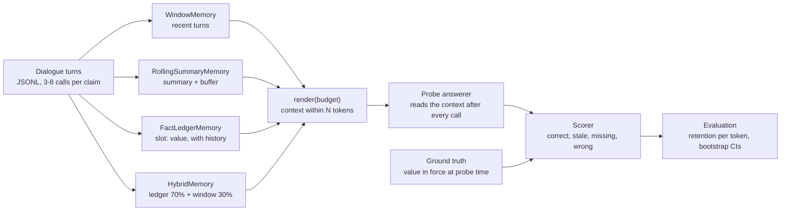

# stalefact

[](https://github.com/SlateGitOrg/stalefact/actions/workflows/ci.yml)


stalefact compares four conversation-memory strategies for an LLM assistant that sits alongside claims handlers across the many calls of a home or motor insurance claim: a sliding window, a rolling summary, a fact ledger and a ledger-plus-window hybrid. Each strategy is probed after every call on facts such as the payout account, and every answer is scored against the value in force at that moment. An answer that gives a fact's old value after it changed is counted as `stale`, a failure, not credited for mentioning the slot. Results are reported as retention per memory token with bootstrap intervals over conversations. All data is synthetic.

## The problem

A claim runs over weeks and many calls, so the assistant cannot keep every transcript in context and the memory has to be compressed. Rolling summaries tend to drop the detail that matters, such as an adjuster's promise to call back by Friday. They also keep the old payout account after the claimant changed it, which is how a payment ends up in a closed account. Teams usually pick a memory strategy by how fluent its output reads, without measuring what it forgets or what it leaves out of date.

This project turns that into a measurement. It generates claim conversations with planted corrections, retractions and one-time facts, runs each strategy under four token budgets, and counts correct, stale, missing and wrong answers separately.

## How it works



* `dialogue.py` and `tokens.py` load turns and count tokens with a deterministic regex counter. The counter approximates real tokenizers (letters in a run are one token, every digit is one token); absolute counts differ from any particular model but are identical for every strategy.
* `memory/` holds the four strategies behind `ingest(turn)` and `render(budget) -> str`.
* `model.py` defines the `MemoryModel` protocol (`summarise`, `extract_facts`, `answer`), a deterministic `FakeMemoryModel` used by tests and the default run, and `OpenAICompatModel`, an httpx adapter configured by `STALEFACT_LLM_BASE_URL`, `STALEFACT_LLM_API_KEY` and `STALEFACT_LLM_MODEL`.
* `probes.py` builds one probe per slot per call and scores answers. `evaluate.py` runs every strategy at every budget and bootstraps 95% intervals over conversations (1,000 seeded resamples).
* `generator.py` and `grammar.py` produce the synthetic claims and the utterance grammar the offline model reads.

## Quick start

```bash
pip install -e ".[dev]"
stalefact seed                                   # writes data/ (120 conversations)
stalefact eval --budgets 128,256,512,1024        # strategy x budget table and breakdowns
stalefact run --strategy rolling --budget 256 --conversation C0055
stalefact trace C0055 --slot payout_account      # value history and each strategy's answers
stalefact sensitivity --seeds 1,2,3,4,5,6,7,8    # stale rate on changed slots across seeds
stalefact eval --answer-policy last              # offline answerer reads the latest mention
pytest -q
```

To use a real model instead of the offline one, set the three `STALEFACT_LLM_*` variables and pass `--model openai`; `STALEFACT_LIVE=1 pytest -m live` runs the one live test.

## Example output

Synthetic data, seed 7, offline model: 120 conversations, 15,689 turns, 3,171 fact-bearing turns, 159 of them on the planted extraction-miss list. `stalefact eval`:

```text
                           Strategy x budget (120 conversations, 95% CI)

  strategy   budget   tokens   retention   retention CI    stale   missing    wrong   ret/100 tok
 ─────────────────────────────────────────────────────────────────────────────────────────────────
  window        128      123       16.0%   [15.2, 16.9]     0.0%     83.9%     0.0%         0.131
  window        256      250       32.4%   [31.1, 33.7]     0.2%     67.4%     0.0%         0.129
  window        512      474       55.9%   [54.2, 57.7]     0.7%     43.4%     0.0%         0.118
  window       1024      777       82.0%   [80.5, 83.6]     1.5%     16.5%     0.0%         0.106
  rolling       128      122       26.2%   [25.1, 27.2]     0.1%     73.7%     0.0%         0.215
  rolling       256      249       57.7%   [56.2, 59.1]     0.9%     41.4%     0.0%         0.232
  rolling       512      473       88.3%   [87.1, 89.5]     1.5%     10.2%     0.0%         0.187
  rolling      1024      772       97.4%   [96.7, 98.0]     2.2%      0.4%     0.0%         0.126
  ledger        128      107       96.4%   [95.5, 97.2]     0.1%      3.5%     0.0%         0.901
  ledger        256      107       96.4%   [95.5, 97.2]     0.1%      3.5%     0.0%         0.901
  ledger        512      107       96.4%   [95.5, 97.2]     0.1%      3.5%     0.0%         0.901
  ledger       1024      107       96.4%   [95.5, 97.2]     0.1%      3.5%     0.0%         0.901
  hybrid        128      120       83.9%   [83.3, 84.4]     0.1%     16.0%     0.0%         0.696
  hybrid        256      179       96.7%   [95.9, 97.5]     0.1%      3.2%     0.0%         0.541
  hybrid        512      255       96.9%   [96.1, 97.6]     0.1%      3.0%     0.0%         0.379
  hybrid       1024      406       97.4%   [96.7, 98.1]     0.1%      2.5%     0.0%         0.240

      Retention by fact age at budget 256

  strategy    age 0    age 1    age 2   age 3+
 ──────────────────────────────────────────────
  window      90.5%    21.1%     0.0%     0.0%
  rolling     84.1%    56.4%    48.9%    37.5%
  ledger      97.2%    96.8%    96.2%    95.4%
  hybrid      98.3%    96.8%    96.2%    95.4%

               Changed vs unchanged slots at budget 256

  strategy   changed n   changed ret   changed stale   unchanged ret
 ────────────────────────────────────────────────────────────────────
  window           263         38.4%            9.1%           32.2%
  rolling          263         36.9%           35.4%           58.2%
  ledger           263         96.2%            3.8%           96.4%
  hybrid           263         96.2%            3.8%           96.7%
```

`tokens` is the mean size of the context actually rendered at probe time, and `ret/100 tok` is correct answers per 100 of those tokens. The ledger needs 107 tokens to hold every slot, so its retention is flat from 128 tokens up and the remaining 3.5% is facts the planted misses made unrecoverable. The rolling summary's stale answers concentrate on changed slots: at budget 256, 35.4% of its probes on changed slots are stale, against 3.8% for the ledger.

The rolling-summary parameters (a 65% summary share and mean TF-IDF salience) were tuned on the default seed, 7, until its stale rate on changed slots at budget 256 reached the 0.30 threshold this project sets for a rolling summary. Other seeds do not all clear it. `stalefact sensitivity` regenerates the data for each seed and reports the stale rate on changed slots at budget 256:

```text
               Changed-slot stale rate by seed at budget 256

  seed   changed probes   rolling stale   ledger stale   ledger retention
 ─────────────────────────────────────────────────────────────────────────
     1              223           30.9%           3.1%              96.5%
     2              235           34.0%           2.6%              96.1%
     3              219           21.9%           5.5%              96.1%
     4              229           27.5%           4.4%              96.5%
     5              238           26.9%           2.1%              96.4%
     6              224           29.0%           4.0%              96.5%
     7              263           35.4%           3.8%              96.4%
     8              238           24.8%           5.0%              96.2%
  mean                            28.8%           3.8%              96.3%
```

The rolling summary is stale on 22% to 35% of changed-slot probes depending on the seed (mean 28.8%, 27.9% without seed 7), against a mean of 3.8% for the ledger, but only seeds 1, 2 and 7 are above 30% for the rolling summary, and the ledger reaches or exceeds 5% on seeds 3 and 8. The seed-7 figure of 35.4% is the high end of the spread, not a typical value.

`stalefact trace C0055 --slot payout_account` shows one claim where the claimant changed the payout account in call 4. The rolling summary keeps answering with the old account after the change; the ledger and the hybrid follow it:

```text
           C0055: payout_account history

  call   turn   event     stated   in force after
 ─────────────────────────────────────────────────
     1     17   assert    7181     7181
     2     11   restate   7181     7181
     4      4   correct   1717     1717
     5      5   restate   1717     1717

                                   Answers at budget 256

  after call   gold   window              rolling          ledger           hybrid
 ──────────────────────────────────────────────────────────────────────────────────────────
           1   7181   7181 (correct)      7181 (correct)   7181 (correct)   7181 (correct)
           2   7181   7181 (correct)      7181 (correct)   7181 (correct)   7181 (correct)
           3   7181   unknown (missing)   7181 (correct)   7181 (correct)   7181 (correct)
           4   1717   1717 (correct)      7181 (stale)     1717 (correct)   1717 (correct)
           5   1717   1717 (correct)      7181 (stale)     1717 (correct)   1717 (correct)
           6   1717   unknown (missing)   7181 (stale)     1717 (correct)   1717 (correct)
           7   1717   unknown (missing)   7181 (stale)     1717 (correct)   1717 (correct)
```

In conversation C0008 the extractor misses the correction on the planted list, so the ledger and hybrid answer with the old account after call 4 (`stale`) until a later turn restates the new one.

## Design decisions

* **Stale is a separate outcome, scored against the value in force.** Gold is the value in force at the end of each call, taken from the generator's ground truth. An answer equal to any earlier value of the slot, including a retracted one, is `stale`; "unknown" is `missing`; anything else is `wrong`. The cost is that a retracted value counts as stale even though it was never in force for long; that is the behaviour that matters when a payment follows the answer.
* **The offline model reads the generator's grammar.** `FakeMemoryModel.extract_facts` compiles the same templates the generator renders, and misses exactly the turns in `planted_misses.yaml`. The experiment therefore measures what strategies forget and supersede, not regex quality, and the planted misses exercise the failure path on purpose. It does not measure how well a real model extracts; the OpenAI-compatible adapter exists for that.
* **The offline answerer reads the first mention, which drives much of the rolling stale rate.** `FakeMemoryModel.answer` returns the value on the first context line that states the slot. The rolling summary keeps sentences in their original order, so when both the old and the new value survive in it the old one comes first and is returned. This is a property of the answerer as much as of the memory. `stalefact eval --answer-policy last` returns the latest mention instead; on seed 7 the rolling summary's stale rate on changed slots then falls from 35.4% to 25.9% at budget 256, from 58.2% to 11.0% at 512 and from 85.9% to 6.5% at 1024. At 256 tokens a majority of the stale answers remain because the summary kept the old value and dropped the new one; at larger budgets most of them come from the answerer's ordering. The ledger renders one line per slot, so it does not depend on the policy. A real model may read a summary more like the "last" policy or more like the "first"; the OpenAI-compatible adapter is the way to find out.
* **A retraction with no earlier value is ignored.** The ledger restores the previous value on `retract`. If it has only one value on record it keeps it, because deleting the only known value would lose a fact the retraction never referred to. If the original statement was itself missed, a retracted change therefore stays current.
* **Budgets are in approximate tokens and strategies fill them differently.** The window fills the whole budget, the rolling summary gives 65% to the summary and the rest to recent turns, and the hybrid splits 70/30. The rolling split and the salience formula (mean TF-IDF of a sentence's words) were tuned on the default seed so the summary meets the 0.30 stale-rate threshold at 256 tokens; that rate on changed slots at that budget moves with the data seed (22% to 35% across eight seeds, mean 28.8%; see the sensitivity table above), so treat the 35.4% figure as the favourable end of that range.
* **Retention per token counts rendered tokens, not the budget.** A strategy that needs 107 tokens is credited for using 107, which is why the ledger's efficiency dwarfs the others. Comparing at equal budget is also available in the table.
* **Intervals resample conversations, not probes.** Probes within a conversation are correlated, so the bootstrap draws whole conversations with a fixed seed, and the same conversations are drawn for every cell. A "changed" slot is one with a correction or retraction by probe time; fact age is the number of calls since the value in force was last stated.

## Testing

```bash
pytest -q
```

120 tests pass and one live-model test is skipped unless `STALEFACT_LIVE=1`. They check the ledger on hand-made turns (v1 then v2 address, "the 12th, sorry, the 14th", retraction), every template round-trip through the grammar, the generator's exact pattern counts, the budget on every strategy after every turn, probe scoring fixtures, the retention and stale thresholds at budget 256, monotone retention across budgets, the ledger's `missing` answers matching the planted-miss list, claimant versus spouse phone, bootstrap reproducibility, the rolling stale rate across seeds, and the effect of the answer policy.

## Project layout

```text
src/stalefact/
  cli.py          seed, run, eval, trace
  dataset.py      turns.jsonl, truth.json, planted_misses.yaml
  dialogue.py     Turn and JSONL loading
  evaluate.py     strategy x budget runs, breakdowns, bootstrap intervals
  generator.py    seeded claim conversations with planted patterns
  grammar.py      14 slots, utterance templates, regex readers
  memory/         window, rolling, ledger, hybrid
  model.py        MemoryModel, FakeMemoryModel, OpenAICompatModel
  probes.py       probes and four-way scoring
  stats.py        bootstrap ratios
  tokens.py       deterministic token counter
  truth.py        ground-truth events and value in force
tests/            pytest suite
```

## License

MIT
